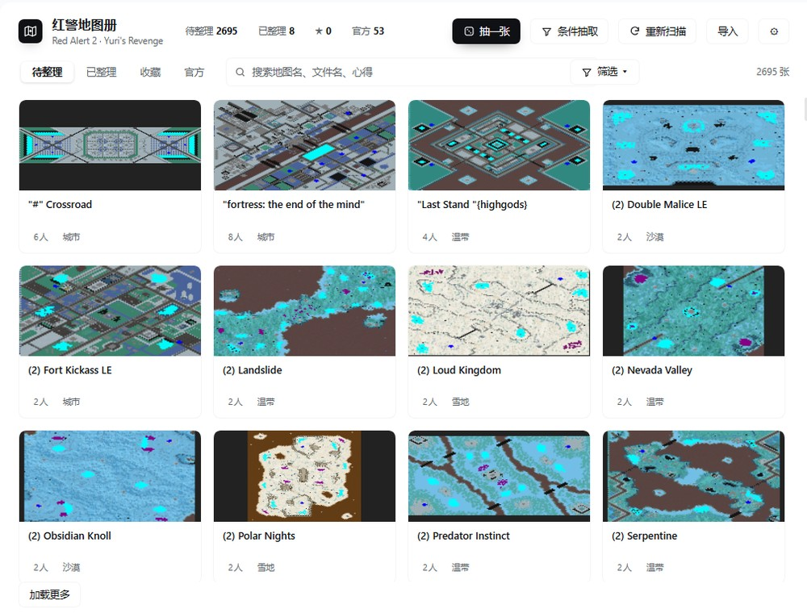
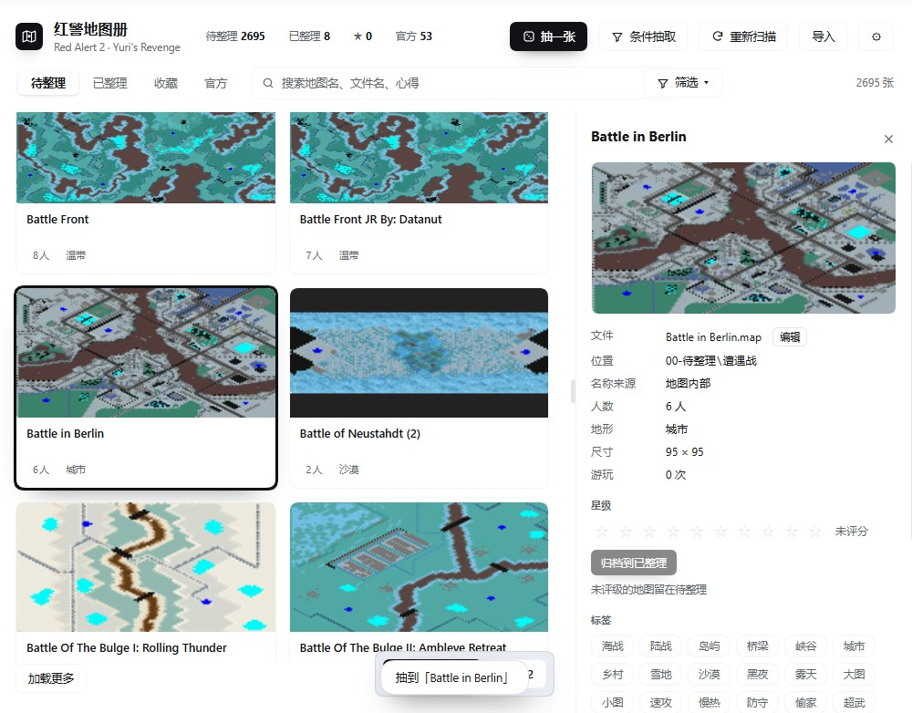
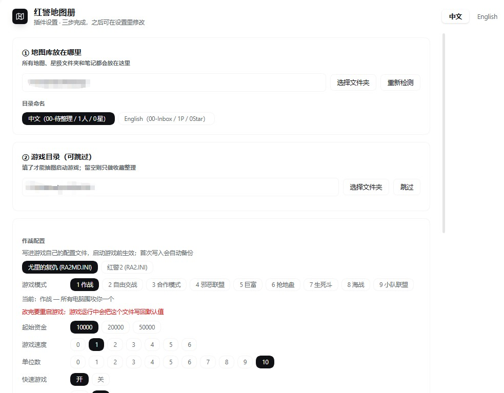

# Map Atlas · 红警地图册

[简体中文](README.md) ｜ **English**

---

Welcome.

If your `.yrm` and `.map` files are scattered across half a dozen folders, and finding a good one means opening them one by one — this plugin is for exactly that.

Map Atlas turns that pile into **a library you can browse**: draw a map into the game, rate it when you are done, and the file files itself into the right `players / stars` folder. Jot down how it plays while it is fresh. Next time you want something specific, filter by players, terrain, rating or tag.

> ⚠️ This is a plugin for **DeepSeek Harness desktop**. It cannot run on its own.

---

## What it does

| | |
|---|---|
| 🗂 **Auto-organise** | Scans the library and reads each map's name, player count, terrain and size |
| 🖼 **Built-in previews** | Decodes the preview image embedded in the map file — no separate screenshots needed |
| 🎲 **Draw into the game** | Picks a map at random or by filter, copies it into the game folder and launches |
| ⭐ **Rate and file** | Rate it, and the file moves into the matching star folder |
| 🏷 **Tags and notes** | Custom tags are shared across the whole library; long notes grow as you type |
| 📊 **Session log** | Duration, mode and outcome, attached to the map |
| ❤️ **Favourites** | Star the ones you like and filter them out anytime |
| 📦 **Bulk import** | Pull an old folder of maps and archives in one go, with policies and undo |
| 🩺 **Crash handling** | Reads the game's crash log; fixes what it can, writes a brief for AI when it cannot |
| 🎮 **Game modes** | Switch between Battle / Free-for-all / Evil Alliance / Rich / Naval and more |
| 💾 **Config migration** | Export and import ratings, tags, notes and favourites |

---

## Screenshots

**The library** — every map shows its own preview, player count and terrain



**Draw and detail** — the drawn map is scrolled into view, with rating, tags and notes on the right



**Plugin settings** — library folder, game folder and gameplay options in one place



*(The UI ships in Chinese and English; the screenshots show the Chinese build.)*

---

## Quick start

### 1. Requirements

- Windows 10 / 11
- **DeepSeek Harness desktop**, installed and running
- Red Alert 2 or Yuri's Revenge (optional — the library works without the game)

### 2. Download and unzip

Download an archive from [Releases](https://github.com/chuvyu/yr-map-atlas/releases) and extract it anywhere.

> You will see two options: `yr-map-atlas-vX.X.X.zip` with the version in the name, or **Source code (zip)** under `Assets`. Both work and contain the same files — pick either.

> `D:\Tools\yr-map-atlas` is a good spot. **Avoid `C:\Program Files`** — it needs admin rights and often fails.

### 3. Install the plugin

Open Harness → Plugin manager → Install plugin → pick the extracted `yr-map-atlas` folder.

**Refresh the page.** A "红警地图册 / Map Atlas" icon appears in the sidebar.

### 4. First-run setup

Three steps:

```
1  Library folder   an empty folder, or your existing map directory
2  Folder naming    Chinese (00-待整理 / 2人 / 0星) or English (00-Inbox / 2P / 0Star)
3  Game folder      your RA2/YR install; skip for a pure collection
```

Press **Build library** and it creates the folder tree and indexes everything.

### 5. Draw one

Press **Draw** in the top right. The map is copied into the game folder and the game starts.

When you are done, press **Save** — give it a rating and it files itself away.

---

## Daily loop

```
1  Add      drop maps into 00-Inbox, or use Import for a whole folder
2  Draw     random, or filter by players / terrain / stars / tags
3  Play     the game launches with the map in place
4  File     rate it and it moves to <players> / <stars>
5  Find     filter, or star the ones you love
```

---

## Folder layout

```
<your library>\
├ 00-Inbox\             unrated maps; the draw pulls from here
│   ├ Maps\
│   ├ Missions\         multi-file mission packages
│   ├ _Packs\           maps that need a matching .mix
│   ├ _Broken\          failed the health check; never drawn
│   └ _Duplicates\      kept duplicates from an import
├ 01-Skirmish\ <2..8>P\ <0..10>Star\
├ 02-Missions\ <faction>\ <0..5>Star\
├ 03-Sources\           archives, previews and other source material
└ .atlas\               index, thumbnails, records (travels with the library)
```

**Everything lives in `.atlas`**, inside the library. Copy the whole folder to another machine and your ratings and notes come along.

---

## Game modes

The game ships with nine skirmish modes its own UI will not let you pick. The plugin writes the setting for you:

| # | Mode | What it is |
|---|---|---|
| 1 | Battle | Every AI attacks you |
| 2 | Free-for-all | Everyone against everyone |
| 3 | Co-op | Team up with a squad |
| 4 | Evil alliance | Build every side's tech |
| 5 | Rich | No ore drills — income from oil derricks |
| 6 | Land grab | Start with a few dogs; grab ground fast |
| 7 | Deathmatch | No high tech |
| 8 | Naval war | No tanks |
| 9 | Squad alliance | Fight the AI alongside an AI |

Path: **gear icon in the panel → Gameplay options**.

Tick **Apply before launch** and the plugin rewrites it every time before starting the game — you never have to remember.

> The game rewrites its own config while running, so this is not a set-once setting. Rewriting it before each launch is the correct approach.

---

## Backup and moving

### New PC

```
Old: Settings → Map Atlas → Config backup → Export
New: install the plugin → Import → copy the whole library folder over
```

The config pack holds **records only** (ratings, tags, notes, favourites, hand-set names) — **not the map files**.

### Import modes

- **Merge** (default, safe): only fills gaps
- **Replace**: overwrites local records with the file's

After importing it tells you how many records had no matching map — normal when the two libraries differ.

---

## FAQ

**No icon in the sidebar after installing?**
Refresh the page (F5). That is almost always it.

**Can I use it without the game?**
Yes. Skip the game folder during setup and you get a pure collection: browse, rate, write notes — just no launching.

**Will it modify my map files?**
It moves them and renames them according to your settings. **It never edits their contents.**

**Does renaming lose my record?**
No. Records are keyed by file content (MD5), so renaming and moving are safe.

**A map crashes on load?**
Press **Auto-fix** in the settlement card; if that fails, **Fix issue** hands the crash context to the AI.

**Does rating a map in the pool file it?**
No — in the pool a rating is only recorded. Press **File it** to move it into the owned set early.

**Several libraries at once?**
One at a time. Switch in Settings; the old library keeps its own data.

**Why do some maps show an unknown player count?**
The map file declares no maximum, and its start points are incomplete. It still plays — it just cannot be filtered by player count.

---

## Known limitations

- Windows only (the game itself is)
- `.rar` / `.7z` extraction needs 7-Zip installed; `.zip` is handled natively
- Nested archives (an archive inside an archive) are not unpacked
- Automatic crash repair covers known structural problems only; the rest goes through the AI brief

---

## Feedback

- Bugs and ideas: [open an issue](https://github.com/chuvyu/yr-map-atlas/issues)
- More from the author: bilibili **一尾醋醋鱼**

Every report has a decent chance of becoming a feature.

---

## License

[MIT](LICENSE) · by **一尾醋醋鱼**

Fork it, remix it, share it — just keep the author credit.

---

<p align="center">Good luck with the draw 🎲</p>
