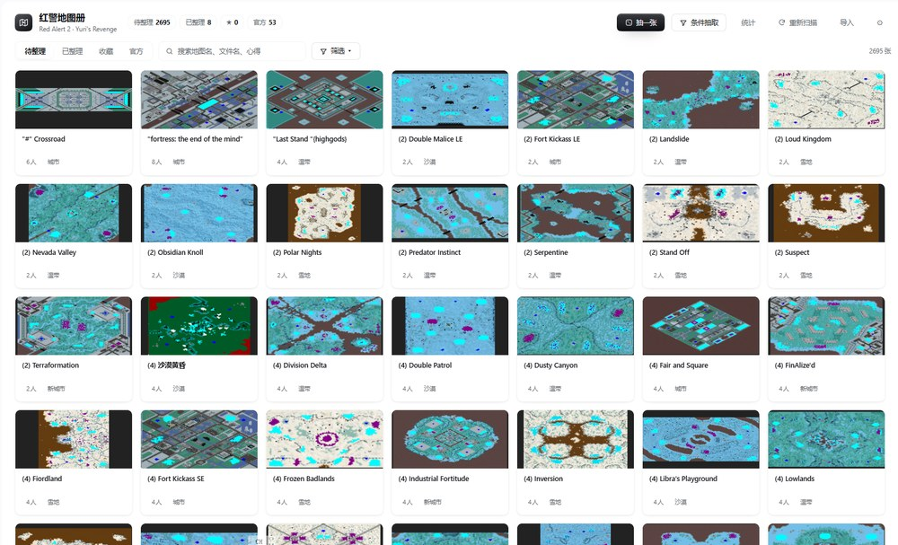
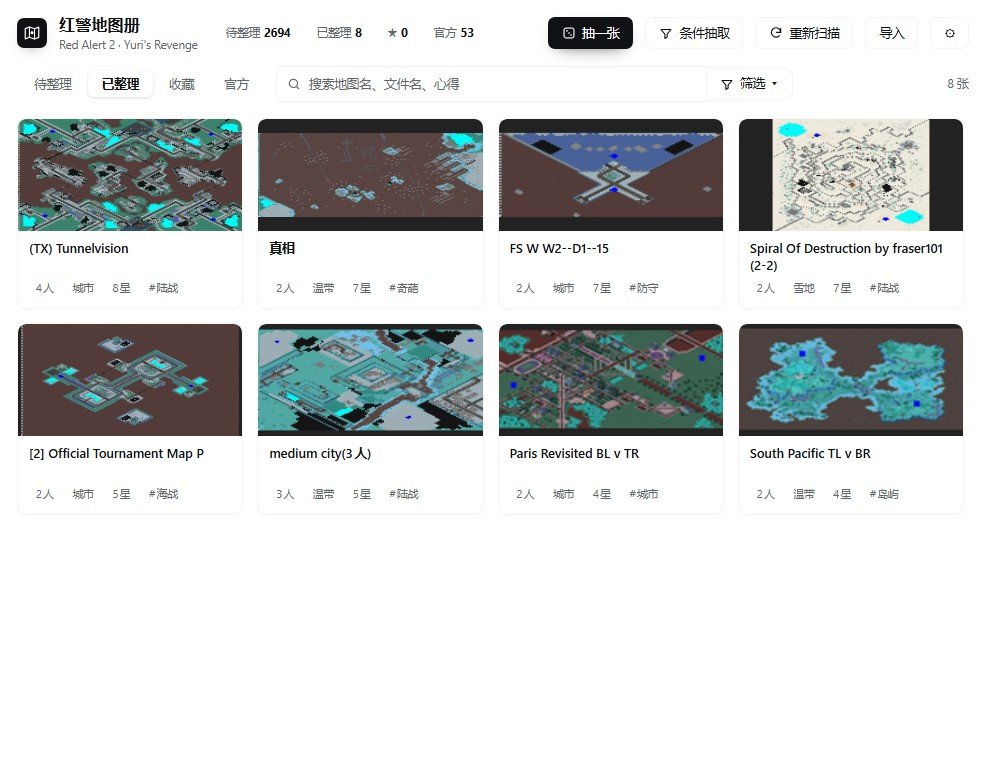
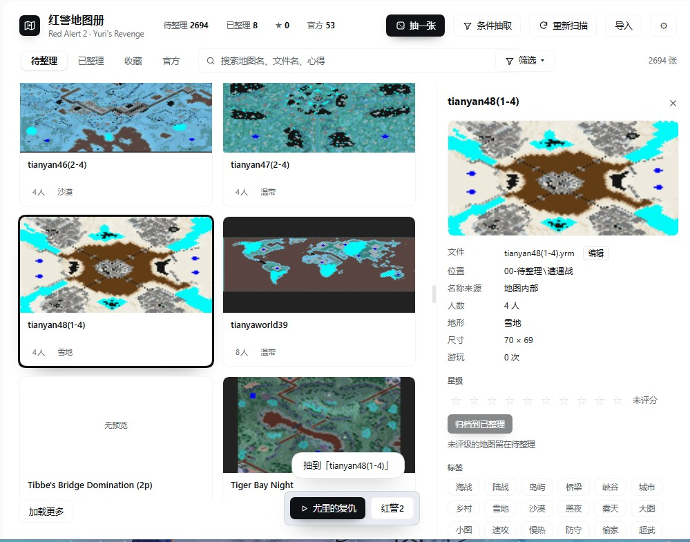
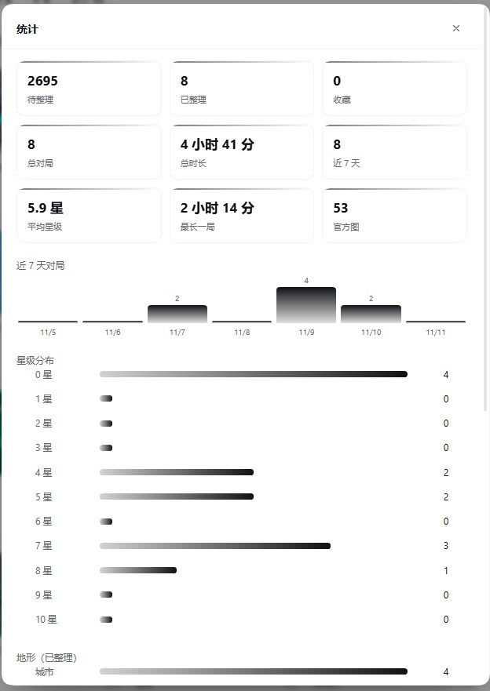
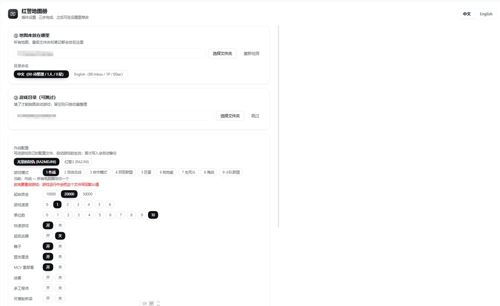
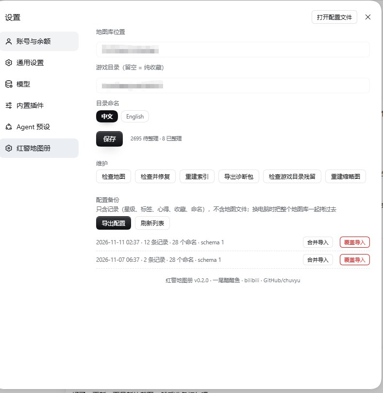

# 红警地图册 · Map Atlas

**简体中文** ｜ [English](README.en.md)

---

欢迎来到红警地图册。

如果你也有一堆散落在各个文件夹里的 `.yrm`、`.map`、压缩包，每次想找张好玩的图都得翻半天——这个插件就是为这件事做的。

它把你的地图整理成一座**可以逛的库**：抽一张进游戏，打完按表现评个星级，文件自动归位到「几人图 / 几星」的文件夹里，顺手记下打法和心得。下次想找图，按人数、地形、星级、标签筛就行。

> ⚠️ 本插件需要配合 **DeepSeek Harness 桌面端** 使用，不能独立运行。

---

## 它能做什么

| 能力 | 说明 |
|---|---|
| 🗂 **自动整理** | 扫描地图库，读出每张图的名称、人数、地形、尺寸 |
| 🖼 **内嵌预览** | 直接解码地图文件里自带的预览图，不用另外找截图 |
| 🎲 **抽图进游戏** | 随机或按条件抽一张，自动复制进游戏目录并启动 |
| 🎯 **抽图偏好** | 可避开最近抽过的图；可按星级加权，高分更容易抽到 |
| ⭐ **星级归位** | 评几星，文件就移动到对应星级文件夹 |
| ✏️ **统一改名** | 文件名、游戏内名称、库内显示名一起改，进游戏也对得上 |
| 🏷 **标签与心得** | 自定义标签全库通用，心得支持长文自动展开 |
| ☑️ **批量操作** | 勾选多张图，一次加标签、移回待整理或删除 |
| 📊 **对局记录** | 记录时长、模式、结果，附在图上 |
| 📈 **统计面板** | 总时长、平均星级、最长一局、近 7 天趋势、星级/地形/人数分布与排行 |
| ❤️ **收藏** | 喜欢的图标个记，随时筛出来 |
| 📦 **批量导入** | 旧文件夹里的地图和压缩包一次性收进来，带策略选择与撤销 |
| 🩺 **崩溃处理** | 读游戏崩溃日志，能修的自动修，修不了的生成工单交给 AI |
| 🔧 **检查与修复** | 全库结构体检：座位数不符、MaxPlayer 缺失等 |
| 🛡 **游戏目录守护** | 检查有没有图遗落在游戏目录，可批量搬回待整理 |
| 🎮 **作战模式** | 一键切换作战/自由交战/邪恶联盟/巨富/海战等 9 种模式 |
| 💾 **配置迁移** | 星级、标签、心得、收藏可导出导入，换电脑不丢 |
| ⌨️ **快捷键** | Esc 关闭详情面板，Ctrl+F 跳到搜索框 |

---

## 界面

**地图库** —— 每张图都带预览，人数和地形一眼看清



**已整理** —— 按人数和星级分层，标签和星级直接标在卡片上



**抽图与详情** —— 抽到后列表自动定位高亮，右侧直接评级、打标签、写心得



**打完评价** —— 从游戏退回来，给星级、打标签、写心得；点「确认归位」，文件自动移到对应文件夹


**统计** —— 打了多久、爱玩几张图、哪个地形最多，点排行直接跳到那张图



**插件设置** —— 地图库路径、游戏目录、作战模式，都在插件的齿轮里



**系统设置里的入口** —— 在 Harness 的「设置」侧栏找到「红警地图册」，插件开关、维护和备份也在这里



---

## 快速开始

### 1. 准备

- Windows 10 / 11
- 已安装并能打开的 **DeepSeek Harness 桌面端**
- 红警 2 或尤里的复仇（可选，不装也能当纯收藏册用）

### 2. 下载与解压

从 [Releases](https://github.com/chuvyu/yr-map-atlas/releases) 下载压缩包，解压到任意目录。

> 页面上有两种可选：带版本号的 `yr-map-atlas-vX.X.X.zip`，或者 `Assets` 里的 **Source code (zip)**。两个都能用，内容一样，任选其一。

> 建议放 `D:\Tools\yr-map-atlas` 这类路径。**不要放 `C:\Program Files`**，那里需要管理员权限，容易装不上。

### 3. 安装插件

打开 Harness → 插件管理 → 安装插件 → 选择解压出来的 `yr-map-atlas` 文件夹。

装好后**刷新页面**，侧边栏会出现「红警地图册」图标。

### 4. 首次设置

点开图标，跟着向导走三步：

```
① 地图库位置   选一个空文件夹，或你已有的地图目录
② 目录命名     中文（00-待整理 / 2人 / 0星）或 English（00-Inbox / 2P / 0Star）
③ 游戏目录     选红警安装目录；不选则进入纯收藏模式
```

点「开始建立」，它会自动建好整套文件夹并扫描。

### 5. 抽一张试试

回到面板，点右上角 **抽一张**。地图会复制进游戏目录、启动游戏。

打完退出，回来点 **确认归位** —— 给个星级，它就归位了。

---

## 日常工作流

```
① 放图    把地图扔进 00-待整理\遭遇战，或点「导入」批量收
② 抽图    点「抽一张」，或用「条件抽取」按人数/地形/星级/标签挑
③ 打完    回到面板点「确认归位」
④ 归位    文件自动移到 01-遭遇战\N人\N星
⑤ 找图    按条件筛选；喜欢的点星收藏
```

---

## 目录结构

```
<你的地图库>\
├ 00-待整理\            还没评价的图，抽图从这里取
│   ├ 遭遇战\
│   ├ 任务\             多文件任务包
│   ├ _地图包\          需要配套 .mix 的图
│   ├ _无法修复\        体检判定损坏的图，不参与抽图
│   └ _重复\            导入时保留的重复副本
├ 01-遭遇战\ <2..8>人\ <0..10>星\
├ 02-任务图\ <阵营>\ <0..5>星\
├ 03-源文件\            压缩包、预览图等原始素材
└ .atlas\               索引、缩略图、记录（跟着库走）
```

**所有记录都在 `.atlas` 里**，跟着地图库走。把整个文件夹拷到另一台机器，星级和心得都还在。

---

## 三个名字

同一张地图在三个地方有名字，插件让它们保持一致：

| 名字 | 在哪看到 | 谁决定 |
|---|---|---|
| 文件名 | 资源管理器里 | 插件按你的改名设置 |
| 游戏内名称 | 游戏选图列表里 | 存在地图文件的 `[Basic] Name` |
| 显示名 | 插件卡片和详情里 | 你的手动命名 |

点「详情 → 编辑」或结算卡上的「改名」，三处一起更新，所以进游戏不会找不到那张图。

改名会先把原文件备份到 `.atlas\backups\rename\`；地图内容（地形、单位、触发）不会被修改。

如果暂时没改名，卡片标题下方会多一行小字「游戏内：xxx」，方便你对照游戏里的名字。

---

## 作战模式

游戏内置了 9 种遭遇战模式，原版界面不让你直接选。插件可以帮你切：

| 值 | 模式 | 说明 |
|---|---|---|
| 1 | 作战 | 所有电脑围攻你一个 |
| 2 | 自由交战 | 大乱斗 |
| 3 | 合作模式 | 和小队协作 |
| 4 | 邪恶联盟 | 可发展所有国家的科技 |
| 5 | 巨富 | 无矿场，只能靠占油井收入 |
| 6 | 抢地盘 | 开局几条狗，地盘全靠抢 |
| 7 | 生死斗 | 无高科技 |
| 8 | 海战 | 无坦克 |
| 9 | 小队联盟 | 和电脑一起打电脑 |

路径：**面板右上角 ⚙ → 作战配置**。

勾上「启动游戏前自动应用」后，每次抽图启动都会自动写入，你不用记。

> 游戏运行时会重写自己的配置文件，所以这些值不是改一次管一辈子——插件每次启动前重写一遍，这才是正确用法。

---

## 备份与迁移

### 换电脑

```
旧机器：设置 → 红警地图册 → 配置备份 → 导出配置
新机器：装好插件 → 导入配置 → 把整个地图库文件夹拷过去
```

配置包里**只有记录**（星级、标签、心得、收藏、手工命名），**不含地图文件**，地图请单独拷。

### 导入方式

- **合并**（默认，安全）：只补本地没有的记录
- **覆盖**：用文件里的记录覆盖本地

导入时会告诉你多少条"落空"——那是这台机器上没有的图，属于正常现象。

---

## 常见问题

**Q：装完侧边栏没图标？**
刷新页面（F5）。99% 是这个原因。

**Q：能不开游戏吗？**
能。首次设置里跳过游戏目录，就是纯收藏模式：浏览、评分、写心得都可以，只是不能抽图进游戏。

**Q：会动我的原始地图吗？**
会动两处：按你的评价移动文件夹、按你的改名更新文件名和文件内的名称。改名前会自动备份，地形、单位、触发这些内容一律不动。

**Q：改名会丢记录吗？**
不会。改名后插件会把星级、标签、心得、对局记录一起迁移到新的文件上。

**Q：地图一进游戏就崩？**
结算卡里先点「一键修复」；修不好再点「异常修复」，把崩溃现场交给 AI 分析。

**Q：待整理里打星会直接归档吗？**
不会。待整理里评级只是记录，文件还留在待整理。想提前归档，点「归档到已整理」。

**Q：打完游戏没有出现结算卡？**
只有在插件里点「抽一张」启动的游戏才会被记录。从桌面图标自己进游戏，插件不知道你玩了哪张图。

**Q：点「放回待整理」之后，地图去哪了？**
放回待整理，不会留在游戏目录里，下次还能抽到它。

**Q：支持多个地图库吗？**
一次一个。换库在设置里改路径，旧库的数据留在旧文件夹里。

**Q：为什么有的图显示"人数未知"？**
地图文件里没写最大人数，且出生点信息不全。不影响玩，只是没法按人数筛。

---

## 已知限制

- 仅 Windows（游戏本身如此）
- 解压：`.zip` 由插件内置解析；`.rar` / `.7z` 走 Windows 自带的 `tar`，无需另装 7-Zip（装了会优先用）
- 不递归处理"压缩包里的压缩包"
- 崩溃自动修复只覆盖已知结构问题，其余依赖 AI 工单
- 官方地图（在 `.mmx` / `.yro` 压缩包内）只读，不能改名或移动

---

## 反馈

- 有问题或建议：[开 Issue](https://github.com/chuvyu/yr-map-atlas/issues)
- 想看更多：bilibili **一尾醋醋鱼**

你的每一条反馈都可能变成下个版本的功能。

---

## 许可

[MIT](LICENSE) · 作者 **一尾醋醋鱼**

转发、二创、二次分发都欢迎，保留作者信息和出处就好。

---

<p align="center">祝你抽到好图 🎲</p>
